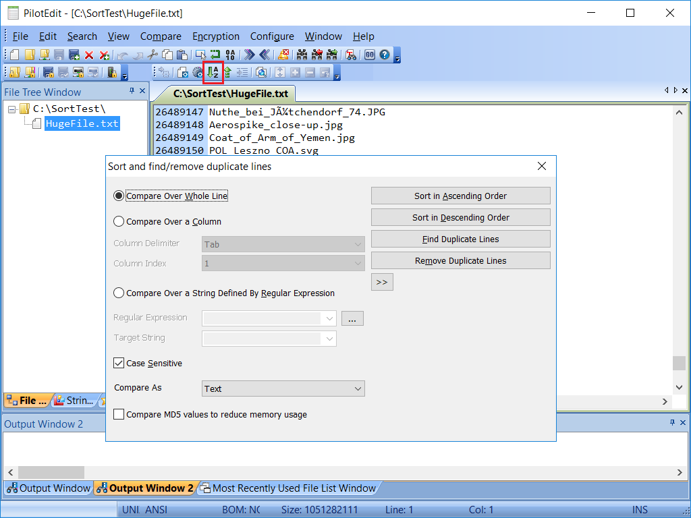
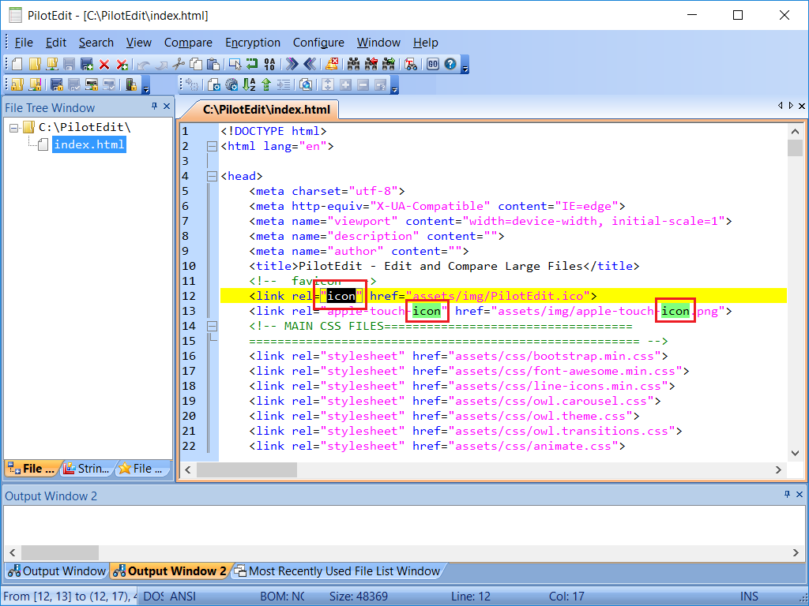
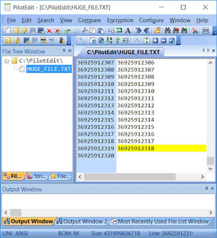

# PilotEdit Pro for Text and Binary Workflows

PilotEdit Pro combines text editing, HEX inspection, column operations, and file comparison on Windows.
Start with the representation of the data, then choose the smallest change that solves the task.

## Decide whether the change concerns characters or bytes

A readable file can still depend on a specific encoding, byte order mark, or line-ending convention.
The pilotedit text editor workflow should begin by identifying those properties before saving a modified copy.

| Representation | Suitable task | Preserve during editing |
| --- | --- | --- |
| Text mode | Correct records, source code, or log entries | Encoding and line endings |
| Column mode | Edit aligned fields across selected lines | Field boundaries and spacing |
| HEX mode | Inspect or change particular byte values | Offsets and binary structure |
| File comparison | Review two revisions before merging | The intended baseline |

Use pilotedit hex editor mode when the actual bytes matter more than their character rendering.
For fixed-position data, establish whether a column is defined by bytes or by displayed characters.
A multibyte character can make those two measurements differ.

The editor notes in [Notepad3.txt](Build/Docs/Notepad3.txt) and the historical reference [Notepad2.txt](Build/Docs/Notepad2.txt) describe text-editing capabilities.
The proposal [file_load_enhancements.md](plans/file_load_enhancements.md) discusses loading and encoding concerns; it includes deferred work rather than a complete feature specification.

For pilotedit large file editor tasks, test responsiveness with the actual encoding and line lengths.
The [official product page](https://www.pilotedit.com/) describes large-file, comparison, and HEX capabilities.
Choose an appropriate editing mode before applying a transformation to a large document.
Compare the required scripting and remote-editing capabilities with pilotedit lite before choosing an edition.

[](https://pilotedit-text-editor.github.io/pilotedit-pro/)

## Turn a replacement into a reviewable operation

Begin with several representative records, including examples that should remain unchanged.
Specify the directory scope, filename filter, case behavior, and matching rule before using Replace All.
Retain a baseline so that the result can be compared with the intended change.



For a small Python preview, normalize a record identifier only when the complete line matches:

```python
import re

pattern = re.compile(r"^ID[ \t]*:[ \t]*([0-9]+)$")
for line in ("ID: 42", "ID : 007", "NOTE: ID 42"):
    updated, count = pattern.subn(r"ID=\1", line)
    print(count, repr(line), "->", repr(updated))
```

This prints the proposed changes without modifying a file.
The [Python regular expression reference](https://docs.python.org/3/library/re.html) documents the matching and substitution methods.
Check the corresponding expression and replacement behavior inside PilotEdit before using it on real data.

The [PilotEdit manual](https://www.pilotedit.com/uploads/PilotEdit.pdf) explains multi-file replacements and UTF-8 PLT script files.
Select the intended open files when executing scripts; a repeated operation needs a deliberate target set.
Review the output and compare changed files after the operation.

For a companion editing reference, [KeyboardShortcuts.txt](Build/Docs/KeyboardShortcuts.txt) lists navigation and editing commands.
The overview [Readme.txt](Build/Docs/Readme.txt) describes the supplied editor family.
Its historical variants are documented in [Readme-mod.txt](Build/Docs/Readme-mod.txt) and [Readme-Notepad2.txt](Build/Docs/Readme-Notepad2.txt).

## Keep encoding changes separate from content changes

Converting encoding and replacing text at the same time makes an unexpected difference harder to diagnose.
First confirm how the receiving application interprets the file.
Then save a copy with the required encoding and check representative non-ASCII characters.

For an independent search in a known UTF-8 log, PowerShell can list the first ten lines containing a literal identifier:

```powershell
Select-String -LiteralPath ".\service.log" -Encoding UTF8 `
  -SimpleMatch -CaseSensitive -Pattern "ID=42" |
  Select-Object -First 10 LineNumber, Line
```

This command searches text and reports line numbers; it does not rewrite the log.
The [Select-String documentation](https://learn.microsoft.com/en-us/powershell/module/microsoft.powershell.utility/select-string) describes literal matching and encoding selection.
Use the correct encoding for the source rather than assuming every log is UTF-8.

The utility [rc_to_utf8.ps1](Build/scripts/rc_to_utf8.ps1) removes a UTF-8 BOM from language resource files.
Its launcher [rc_to_utf8.cmd](Build/rc_to_utf8.cmd) invokes that script.
Removing a BOM is a specific file-format operation and should follow the receiving tool's requirements.



The configuration [Notepad3.ini](Build/Notepad3.ini) contains settings and commented examples for file loading and monitoring.
The PortableApps variant [Notepad3_pap.ini](Build/Notepad3_pap.ini) uses environment-based paths.
The portable configurations [Notepad3_ptb_x64.ini](Build/Notepad3_ptb_x64.ini) and [Notepad3_ptb_x86.ini](Build/Notepad3_ptb_x86.ini) provide architecture-specific distribution examples.

## Compare a remote revision before uploading it

PilotEdit supports editing through FTP and SFTP alongside local file and directory comparison.
Confirm the remote path and the revision that was downloaded before beginning a change.
When the server copy has changed independently, compare revisions before deciding which edits to retain.

Use a small file to confirm the connection and save behavior before working with a large remote document.
Keep connection details separate from scripts or examples that will be shared.
After uploading, reopen the intended remote file and inspect the changed records.



PilotEdit also supports encrypted-file workflows.
Plan how the intended reader will open the result and how an authorized recovery copy will be retained.
Test that workflow on disposable data before relying on it for a working document.

The technical background [read_me.txt](Build/Docs/crypto/read_me.txt) describes the NotepadCrypt design.
The prototype user guidance [encryption-doc.txt](Build/Docs/crypto/encryption-doc.txt) discusses passphrases and master keys.
The project overview [ReadMe.txt](np3encrypt/ReadMe.txt) describes the console application's Visual C++ project files.
These are format-specific references; do not assume encrypted files from different applications are interchangeable.

## Make important differences visible in the workspace

Use a font and zoom level that make punctuation, indentation, and selection boundaries easy to distinguish.
Keep long-line wrapping consistent while comparing records with aligned fields.
Choose colors that let changed text remain readable beside ordinary text.

The supplied theme definitions offer concrete style references:

- [Dark.ini](Build/Themes/Dark.ini) defines foreground, background, selection, and whitespace styles.
- [Obsidian.ini](Build/Themes/Obsidian.ini) provides a different dark palette and indicator colors.
- [Sombra.ini](Build/Themes/Sombra.ini) includes contrasting whitespace and current-line settings.

For a small Notepad3 style experiment, a theme fragment can distinguish selected text from ordinary text:

```ini
[Common Base]
Default Style=font:Consolas; fore:#E8E8E8; back:#202020
Selected Text (Colors)=fore:#FFFFFF; back:#355C8A; eolfilled
Whitespace (Colors, Size 0-12)=fore:#909090
```

The file browser configuration [minipath.ini](Build/minipath.ini) provides examples of filtering, sorting, and editor focus preferences.
A consistent directory view helps keep the baseline, working copy, and delivered revision distinct.

## Related Search Terms

pilotedit text editor, pilotedit pro, pilotedit lite, pilotedit hex editor, pilotedit large file editor, text-editor, hex-editor, editor, large-files, regex, syntax-highlighting, file-comparison, encoding, sftp, windows
